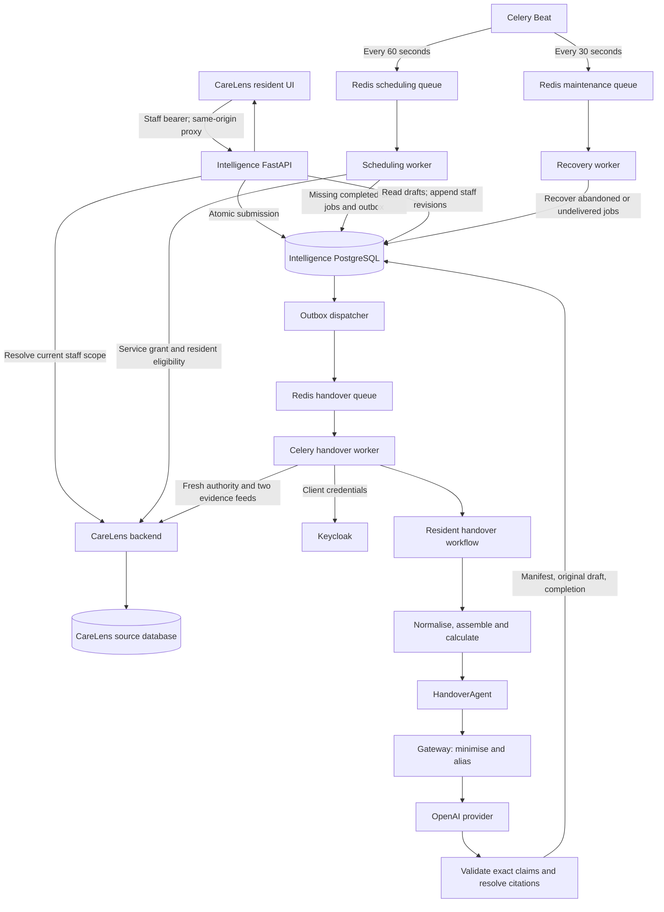

# CareLens handover agent: end-to-end architecture and data flow

**Implementation review: 8 October 2026.** Based on repository revision `4de0ab0` plus the current working tree, including uncommitted CareLens care-event integration and resident UI files. This describes the code present, not a claim that the complete deployed system has passed live validation.

## 1. Where the implementation stands

The separate intelligence service now contains a connected implementation from manual or scheduled submission to an evidence-backed, persisted handover draft and staff revisions in the CareLens resident UI.

The implemented path is:

**CareLens UI or scheduled sweep → durable PostgreSQL job and outbox → dispatcher → Redis → Celery worker → fresh CareLens authority checks → care events and 14 clinical sources → evidence validation and trusted calculations → handover agent → privacy gateway → OpenAI structured response → deterministic validation and citation resolution → immutable original draft → CareLens review UI → immutable staff revisions.**

The path currently ends at **draft review and editing**. Nurse-in-charge finalisation, signed official care-record publication, automatic amendments after source corrections, and full operational/clinical validation remain outstanding.

The most important distinctions are:

| Question | Current implementation |
|---|---|
| Is the intelligence layer separate? | Yes: its own Python service, API, background processes, Redis deployment and PostgreSQL persistence boundary. It reads CareLens through HTTP APIs. |
| Is Celery/Redis wired in? | Yes: generation, scheduling and maintenance queues, with a PostgreSQL outbox and recovery. |
| Is orchestration implemented? | Yes, as explicit Python workflow code plus durable database state. No LLM supervisor, LangGraph or multi-agent conversation coordinates this path. |
| Is the real connector used? | Yes, by the durable handover worker. A separate legacy `/v1/runs` path still uses synthetic evidence. |
| Does the LLM invent a narrative from all raw notes? | No. Trusted code prepares approved sentences; the provider must return every approved claim with exact text and citations. |
| Does the model receive identifiable source records? | The intended provider contract excludes real IDs, credentials and raw records. It receives minimised clinical statements and request-local aliases. These statements still contain sensitive clinical information. |
| Are all source records usable today? | No. Narrative fields can fail the closed text policy; unmapped care-event detail is withheld. Pagination does not prove a consistent snapshot. |
| Can staff edit? | Yes, when freshly authorised for generation and resident access. Each save appends a staff revision. |
| Can the nurse in charge finalise? | Not yet. The agreed policy is not implemented as a sign-off endpoint, designation check or official-record write. |
| Is live end-to-end operation verified by this report? | No. Offline tests passed; PostgreSQL integration tests were skipped, and no live provider, broker or browser run was performed. |

## 2. Architecture and responsibilities



### Runtime components

| Component | Responsibility | Main code |
|---|---|---|
| CareLens frontend | Shift selection, submission, polling, draft display, evidence review and editing | `frontend/src/components/residents/`, `frontend/src/lib/handoverInsights.ts` |
| CareLens backend | Owns clinical records, staff permissions, tenant/floor access and service enrolment | `app/modules/identity/intelligence_router.py`, `intelligence_access.py` |
| Intelligence API | Authenticated submission, status and review APIs; commits jobs before replying | `src/intelligence/api/` |
| Scheduler | Reconciles completed shifts into durable jobs | `workers/scheduling.py` |
| Dispatcher | Publishes committed outbox entries to Redis | `dispatcher/` |
| Generation worker | Runs one resident/shift workflow per claimed job | `tasks/handover.py`, `workers/handover_execution.py` |
| Recovery worker | Recovers expired execution leases and old published-but-unconsumed jobs | `workers/recovery.py`, `persistence/recovery_repository.py` |
| PostgreSQL | Authoritative job, publication, evidence and draft history | `persistence/`, `migrations/versions/` |
| Redis | Celery transport; it is not the clinical record store or draft store | `compose.yaml`, `workers/celery_app.py` |
| Gateway and provider | Minimise inputs, constrain model interaction, validate outputs | `gateway/`, `providers/` |

Paths beginning with `src/`, `workers/`, `gateway/` and similar refer to the intelligence service's source tree unless otherwise stated.

### Stack declared in the repository

The service declares Python `>=3.12,<3.14`, FastAPI, Pydantic 2, SQLAlchemy 2 async sessions, psycopg, Alembic, HTTPX, Celery, Redis and the OpenAI Python SDK. `pyproject.toml` contains dependency constraints; the Docker image installs `requirements.lock`. Docker uses Python 3.12 slim and runs the application as a non-root user. The frontend uses the existing React/TypeScript/Vite application.

This is a deterministic workflow with one bounded model-assisted agent. Celery moves work between processes; PostgreSQL coordinates durable state; Python functions enforce the order of execution. An LLM does not choose tenants, permissions, sources, retry policy or persistence operations.

## 3. Entry points and API inventory

### Browser-facing intelligence endpoints

Browser requests use `/intelligence/v1/handovers/...`. The Vite proxy strips `/intelligence` and forwards to the intelligence API on local port 8100. A deployed environment needs an equivalent reverse-proxy route.

| Method and service path | Purpose |
|---|---|
| `GET /v1/handovers/residents/{resident_id}/shifts` | Returns the last four completed local shifts. |
| `POST /v1/handovers` | Submits or reuses a resident/shift job; requires `Idempotency-Key`; returns HTTP 202, job state and status URL. |
| `GET /v1/handovers/{job_id}` | Returns authorised job status. |
| `GET /v1/handovers/{job_id}/draft` | Returns the exact job's latest draft version and original AI content. |
| `GET /v1/handovers/residents/{resident_id}/latest` | Returns the newest available draft by shift end; returns null if none exists. |
| `GET /v1/handovers/{job_id}/evidence` | Returns evidence manifest metadata and immutable version history. |
| `POST /v1/handovers/{job_id}/revisions` | Appends a staff edit using `expected_version_id` and `text`. |
| `GET /healthz` | Process liveness. |
| `GET /readyz` | Bounded PostgreSQL connectivity check. |

There is no current finalise, regenerate, source-amendment or cancellation endpoint in this handover API. The database supports some future states/history fields that do not yet have a user-facing workflow.

### CareLens integration endpoints

| Path | Caller and purpose |
|---|---|
| `/identity/intelligence-scope` | Intelligence API forwards the staff bearer token to resolve current staff scope. |
| `/internal/intelligence/authority/service` | Worker/scheduler obtains current service grant. |
| `/internal/intelligence/authority/staff/{actor_id}` | Worker rechecks the initiating staff member for a manual job. |
| `/internal/intelligence/authority/residents/{resident_id}/eligibility` | Checks pilot eligibility and current resident state. |
| `/internal/intelligence/observations` | Reads the historical clinical projection, with period and pagination. |
| `/internal/intelligence/care-events` | Reads structured care-event history, with period and pagination. |

Internal endpoints require a service bearer token and tenant scope. The intelligence service does not query the CareLens database directly or write clinical source records through these endpoints.

## 4. Manual generation, step by step

1. An authorised staff member opens a resident's handover generation dialog. The browser retrieves completed shifts from the server.
2. The browser submits resident ID, shift start and shift end, with a stable idempotency key for that submission attempt. It does not submit trusted tenant permissions or service credentials.
3. `api/dependencies.py` resolves the bearer token against CareLens. Missing/invalid credentials produce 401, denied intelligence access 403, and an unavailable identity service 503.
4. `handover/service.py` requires `handover:generate` and access to the resident. It validates that the requested shift has finished and matches the configured local 07:00–19:00 or 19:00–07:00 window.
5. A PostgreSQL transaction sets the tenant context and acquires a tenant/resident advisory lock. The service checks an existing idempotency mapping and an existing first-generation job for that shift.
6. If necessary, it inserts a job and its pending dispatch-outbox entry together. It also records the actor-scoped submission key and request fingerprint.
7. The API responds after the transaction commits. The response acknowledges durable acceptance; generation has not necessarily begun.
8. The dispatcher publishes the outbox entry. The worker claims and executes the job.
9. The UI polls approximately every three seconds. When the state becomes `draft_ready`, it fetches that exact job's draft, including when the user deliberately selected an older shift.

Reusing a key with a different request returns 409. Concurrent/manual/scheduled requests for the same resident/shift reuse the same first-generation job. Repeated submission of a failed job also reuses it; clicking again is not a regeneration mechanism.

## 5. Scheduled generation and shift semantics

Celery Beat submits a scheduling sweep every 60 seconds to `intelligence.scheduling`. The scheduling worker does not call the model. It enumerates trusted configured tenants, obtains service credentials, checks the service grant, checks eligible residents and creates any missing jobs for completed shifts.

Scheduling is disabled by default through `INTELLIGENCE_SCHEDULE_ENABLED=false`. When explicitly enabled, the default catch-up window is the last four completed shifts, configurable from 1 to 14. Enabling it can therefore submit historical jobs immediately, not just the next shift.

The scheduling authority requires both `handover:generate` and `handover:schedule`. Scheduled jobs carry service identity and no impersonated staff actor. The generation worker rechecks this authority later.

Shift windows are half-open:

| Generation boundary | Evidence interval |
|---|---|
| 19:00 | Same-day 07:00 inclusive to 19:00 exclusive |
| 07:00 | Previous-day 19:00 inclusive to current-day 07:00 exclusive |

Thus the current feature produces a **shift summary**, not a rolling 24-hour summary. An event at exactly 19:00 belongs to the following night shift. Local calendar boundaries are converted to UTC instants; daylight-saving changes can make an overnight shift 11 or 13 elapsed hours.

Generation becomes eligible at the boundary and is picked up by a subsequent sweep, subject to queue delay. There is no promise of a finished draft at exactly 07:00 or 19:00.

The current timezone comes from service configuration, defaulting to `Europe/London`; it is not dynamically selected from each tenant by the scheduling code. This fits the current UK pilot but needs extension for multiple home timezones.

## 6. Durable dispatch, execution ownership and recovery

### Why both an outbox and Redis exist

PostgreSQL commits the job and the intention to publish together. This avoids a request being accepted with no durable delivery record if Redis is unavailable. Redis transports only `tenant_id` and `job_id`; clinical evidence and access tokens are not task arguments.

The dispatcher claims a due outbox entry under a 60-second publication lease, commits that reservation, publishes outside the database transaction, then records publication. Broker publication has a 15-second outer timeout. Unconfirmed publication retries indefinitely with exponential delay and jitter, capped at 300 seconds.

Delivery is **at least once**. If publication succeeds but acknowledgement/bookkeeping fails, duplicate messages are possible. A Celery task ID helps tracing; it is not the deduplication mechanism.

### Worker execution

`intelligence.handover.generate` is a synchronous Celery task wrapper that starts an async execution loop. The worker creates and closes HTTP/provider/database resources within the execution lifecycle.

The database claim changes an eligible queued job to running, increments its attempt count and assigns a lease token. A duplicate message that cannot claim the job performs no generation. The running workflow renews its 60-second lease every 15 seconds, with a 10-second renewal timeout. Loss or uncertainty of ownership stops processing. A final ownership check precedes persistence, and persistence checks ownership again at commit preparation.

```mermaid
stateDiagram-v2
    [*] --> queued: Submission transaction
    queued --> running: Worker claim and attempt increment
    running --> draft_ready: Validated draft and manifest commit
    running --> queued: Retryable failure or expired lease; attempts remain
    running --> failed: Terminal failure or attempts exhausted
    queued --> queued: Published delivery stale; redispatch
    draft_ready --> draft_ready: Append staff revision
```



`cancelled` is a supported schema state but has no current cancellation API. Draft edits do not mark a job clinically finalised.

### Failure policy

| Condition | Current behaviour |
|---|---|
| Explicit service/staff/resident access denial | Terminal failure. |
| Privacy or outbound validation rejection | Terminal failure; no accepted draft. |
| Invalid provider output reaching inbound validation | Terminal failure. |
| Gateway-level provider timeout | Retry after 30 seconds, within the job attempt budget. |
| Temporary CareLens or authority unavailability | Retry after 30 seconds, within the budget. |
| Lease lost or uncertain | Leave state alone; do not overwrite another attempt. |
| Unexpected error, including generic provider errors | Terminal `internal_error` under the current classifier. |
| Worker disappears | Recovery can requeue after lease expiry, or fail after the attempt budget. |
| Published message never claims the queued job | Recovery can redispatch after the configured stale interval, default 300 seconds. |

The default execution budget is three attempts. Provider SDK retries are disabled; PostgreSQL/outbox owns workflow retries. The code does not currently classify every provider 429/5xx/SDK timeout into a retryable category: the gateway wraps generic SDK exceptions as `HandoverProviderError`, which falls through to `internal_error`.

Beat enqueues recovery every 30 seconds on `intelligence.maintenance`. Each tenant sweep processes bounded batches of expired and stale queued jobs. Recovery checks row ownership under locks and creates a new outbox entry transactionally.

Failures before a job is claimed—for example credential/provider-runtime initialisation—can leave it queued. Stale-delivery recovery may publish it again; persistent configuration failures need operator alerts rather than relying on the execution-attempt counter alone.

This design protects accepted draft persistence against duplicate execution. It cannot guarantee exactly one paid provider request: an external call may succeed before a worker disappears or loses its lease.

## 7. Authentication, permissions and trust boundaries

There are two independent identities:

**Staff identity:** the browser's bearer token is resolved by CareLens. The current pilot checks that staff are active, explicitly listed in `generating_staff_ids`, have `view_handover`, `view_resident` and `view_observation`, and retain access to the relevant floors/residents.

**Service identity:** the worker uses Keycloak client credentials. CareLens validates the signed token, issuer, audience, expiry, subject and authorised client against configured service grants. A service token does not create or impersonate a staff user.

CareLens combines tenant, registered service resident scope, floor scope and resident eligibility. Eligibility requires a resident to be enrolled, visible, active, not deleted and not discharged. For manual execution the worker intersects current service and initiating-staff permissions. Scheduled execution additionally requires scheduling permission.

Intelligence transactions set `intelligence.tenant_id`. Migrations enable and force tenant row-level security and grant the application role limited privileges. Resident filtering is also explicit in API/repository queries. These protections depend on deployment using the intended non-privileged application role and applied migrations; a connection check does not verify that configuration.

Permissions are rechecked when work starts and when staff read or edit drafts. This is not a continuous authorisation subscription: the workflow does not perform a separate final permission check immediately before saving after the model call.

## 8. Clinical retrieval: care events plus 14 sources

The old historical-data mismatch is addressed by a CareLens read projection. Existing records remain in their domain tables; there is no required copying into the generic observations table for this feed.

| Source table | Normalised kind | Clinical time used |
|---|---|---|
| `fluid_intake_records` | `fluid_intake` | `recorded_at` |
| `food_intake_records` | `meal` | `recorded_at` |
| `weight_records` | `weight` | `recorded_at` |
| `vital_signs_records` | `vitals` | `recorded_at` |
| `mobility_observations` | `mobility` | `recorded_at` |
| `continence_records` | `continence` | `recorded_at` |
| `wellbeing_records` | `wellbeing` | `recorded_at` |
| `behaviour_records` | `behaviour` | `occurred_at` |
| `communication_logs` | `communication` | `recorded_at` |
| `sleep_records` | `sleep` | `night_of`, date only |
| `pain_assessments` | `pain` | `assessed_at` |
| `falls_incidents` | `fall` | `occurred_at` |
| `incidents` | `incident` | `occurred_at` |
| `wound_records` | `wound` | `first_observed`, date only |

`app/modules/observations/clinical_feed.py` builds the projection; `repository.py` applies resident, time and paging filters under the caller's RLS scope. The feed also contains native `observations` rows, but intelligence normalisation deliberately excludes those from this pilot.

Care events arrive through a separate endpoint implemented in `app/modules/care_recording/intelligence_feed.py`. It supplies event time, actual creation/update timestamps, status, template/category metadata, section-qualified options and measurements. Child collections are aggregated to avoid multiplying event rows. The transport envelope uses `source_type=care_events` and `type=note`, then intelligence maps recognised events to their care category.

### Pagination and coverage

The connector requests pages of 100 by default and allows 100 page requests per feed, including the terminating empty page. It advances by the raw row count, including excluded sources, and continues past short non-empty pages. Wrong-resident rows, out-of-window rows, duplicate composite identities, malformed responses, later-page failures or exhausting the page budget prevent a partial result being used.

This still uses offset pagination across separate HTTP reads. Concurrent inserts, updates or deletions can produce undetected omissions. Therefore the workflow explicitly stores:

```text
coverage_complete = false
evidence_cutoff = null
source_checkpoint = null
```

Successful traversal is not proof that every relevant record existed in one consistent snapshot, or that all care performed was recorded.

### Time handling and source identity

Clinical observations are fetched for the local calendar days overlapping the shift, so date-only sleep/wound records are not lost by midnight projection. Care events are fetched for the exact shift interval. Assembly then separates timestamped shift records, date-context records and supported unknown-time evidence. Timestamped records outside the shift are excluded. The current HTTP transport itself requires timestamp or date precision; unknown-time support is primarily in the internal evidence contracts.

The observations API field `recorded_at` represents the projected clinical time. The normaliser correctly stores it as `effective_at`; it does not claim to know a separate entry timestamp. Care-event evidence can additionally preserve `created_at` as entry time.

Every source reference includes system, source type, source UUID, version and SHA-256 content fingerprint. Clinical projections currently use `version=unversioned`; care events use the event update timestamp. A fingerprint detects a changed payload if retrieved again, but it is not a historical snapshot or a change-feed cursor. Current care-template metadata can also change independently of an event.

## 9. Normalisation and calculations

`connectors/normalise.py` checks resident scope and source/type combinations. `connectors/care_events.py` implements the current conservative `care-events-v2` mapping. `handover/evidence.py` validates tenant/resident identity and temporal membership before calculations.

Care-event mapping recognises a controlled subset of nutrition/hydration, mobility and emotional-support/behaviour choices. Exact section/option combinations become flags such as walking-frame use, supervision, meal portion, settled response or quantity offered. Two exact whole-note garden-wandering phrases have explicit mappings; arbitrary notes do not.

Unknown categories remain evidence with a warning. Refused, declined and not-applicable status remain distinct from completed care. Raw notes, summaries, option notes and unmapped measurements are retained only in internal source data and withheld from the provider path.

`handover/metrics.py` uses `Decimal` and source references to calculate recorded fluid quantities, meal portions and record counts. It distinguishes complete, partial, no-records and ambiguous states. A usable full-period value is exposed only when completeness is established; the current workflow keeps totals partial or ambiguous rather than asserting complete intake.

Specific safeguards include:

- Date-only and unknown-time records do not enter exact shift metrics or counts.
- Missing consumed or offered quantities do not become zero or substitute for each other.
- Conflicting quantity aliases reject calculation.
- Linked cumulative intake requires explicit offer linkage, ordering and an opening baseline; incompatible records remain ambiguous.
- Repeated linked offers are not repeatedly added as separate offered amounts.
- Care-event “150 ml offered, half consumed” can yield an **estimated** 75 ml, but does not become an exact measured consumed value.
- Qualitative meal choices such as “most” are not converted into invented percentages.

The readable overview may combine recognised drink estimates only under its own consistency checks, preserving approximate wording. It does not change the exact fluid metric contract.

The same real-world care action may exist in both a clinical table and a care-event record. There is no universal cross-source semantic linkage, so source-identity deduplication cannot guarantee removal of those duplicates.

## 10. Agent, gateway and model boundary

### Contract evolution

The original `SafePayload`, `ProviderClaim`, `ProviderOutput` and `Provider` contracts still exist for the older structured demo path. The durable handover workflow uses the richer contracts:

```text
HandoverAgentInput
  → PreparedHandover (private wrapper)
  → HandoverPayload (minimised evidence and calculated metrics)
  → HandoverOutput (aliased structured claims)
  → ValidatedHandoverContent (internal source references)
```

`HandoverAgent` is a small wrapper around `HandoverGateway`. Its current identity is `handover_draft`, version `0.1.0`, permission `handover:generate`. The worker constructs it directly; the old `AgentRegistry` is not the dispatch mechanism for this durable workflow.

### Gateway stages

1. **Validate internal input.** Check scope, evidence, temporal groups and trusted calculations. Make a detached copy so caller mutation does not silently change prepared input.
2. **Render approved fields.** Source-specific rules choose data fields and care sections; there is no arbitrary serialisation of all source dictionaries.
3. **Apply text policy.** Source strings need exact, trusted reviewed replacements. The default policy is empty.
4. **Create request-local aliases.** Replace resident and source identities with aliases such as `RESIDENT_001` and `SRC_001`. Keep the reverse map private.
5. **Validate outbound content.** Check types, identifiers, citations, metric consistency and size limits.
6. **Call the provider with a timeout.** The provider receives only its minimised contract representation.
7. **Validate inbound claims.** Check resident alias, source/metric aliases, exact approved text, category, time context, duplicate claims and complete claim coverage.
8. **Resolve internal references.** Convert approved source aliases back to authorised `SourceRef` values. Resident identity remains trusted draft metadata; there is no global name replacement in model prose.

**Important current limitation:** the worker passes `reviewed_text_policy=None`, so the default replacement map is empty. For historical clinical sources, a non-empty allowlisted string—such as notes, a meal-type string or fluid-type string—can cause the whole job to fail with privacy rejection. It is not automatically anonymised or simply omitted. Care events largely avoid that path by mapping selected information into numeric/boolean fields and explicitly withholding other text. This must be exercised with representative clinical records before considering the 14-source path broadly usable.

Identifier-pattern screening is defence in depth, not a complete name/PII detector. Pseudonymisation also does not make clinical facts non-confidential. The intelligence process itself handles identifiable evidence and needs the same protected deployment treatment as other sensitive processing.

### What is actually sent to OpenAI

`providers/openai_handover.py` derives `approved_claims` from the validated payload. The provider request contains a resident alias and approved claim objects with section, temporal context, approved text, source aliases and metric aliases. The full internal evidence object, identity map, credentials and source UUIDs are not sent.

Trusted code in `handover/prose.py` produces readable supported sentences. The system prompt asks the model to return each exactly once, grouped by care category. Returned text must match the trusted sentence exactly. New diagnoses, recommendations, invented totals, causal links, altered wording or omitted claims cannot pass that contract.

Consequently the model's present role is constrained structured organisation. Much of the clinical interpretation and all accepted sentence content come from application code. This is a deliberate implementation property to understand before expecting open-ended summarisation or deterioration detection.

### Provider configuration and limits

The runtime creates an `AsyncOpenAI` client, uses structured `responses.parse`, sets `store=False`, disables SDK retries and closes the client after use. The endpoint is currently fixed to `https://api.openai.com/v1`; deploying the service on Azure would not automatically route model processing through Azure OpenAI.

The code's default `OPENAI_MODEL` is `gpt-6.1-sol`. This is a repository configuration value, not verification of model availability for the deployed account. Missing keys or unsupported provider configuration fail rather than silently switching to a fake provider. `store=False` alone does not establish a contractual retention or processing-location arrangement.

| Bound | Current value |
|---|---|
| Provider timeout default | 25 seconds |
| Maximum output tokens default | 4,096 |
| Payload evidence objects | 500 |
| Output claims | 80 |
| Outbound payload bytes | 256,000 |
| Inbound output bytes | 64,000 |
| Claim text length | 2,000 characters |

The 80-claim limit is the practical earlier bound: one claim is required per evidence item plus every sourced metric. A payload with fewer than 500 records can therefore still be rejected before a model call. Chunking and multi-stage aggregation are not implemented. Token capacity can also be exhausted below the structural limits.

## 11. Persistence and the meaning of immutability

| Table | Stored information |
|---|---|
| `handover_jobs` | Tenant/resident, shift, initiator, trigger, execution identity, state, attempt budget, lease, failure code and generation lineage. |
| `dispatch_outbox` | Durable task publication, dispatch number, availability time, publication lease and result. |
| `idempotency_records` | Tenant/actor/request key, request fingerprint and corresponding job. |
| `evidence_manifests` | Retrieval time, coverage/cutoff, source references and fingerprints, temporal groups and warnings. |
| `handover_draft_versions` | Original AI claims or staff prose, version chain, author, manifest link and generation metadata. |

Completion is one database transaction: lock and validate ownership → insert manifest → insert original version → recheck lease and mark `draft_ready`. If ownership expires or any step fails, the transaction rolls back; it does not expose a half-saved completed job.

The manifest records all assembled evidence references, including date context, but **does not store a complete immutable copy of every raw source record**. The original draft stores supported claims with references. CareLens remains the source of the original clinical content. Historical reconstruction after a source edit/deletion is therefore not guaranteed by the manifest alone.

Database triggers reject updates to evidence manifests and draft versions. The application role has SELECT/INSERT privileges for these records and no ordinary DELETE privilege. Jobs/outbox remain mutable because their lifecycle changes. Privileged maintenance access still needs governance; application immutability is not a claim of tamper-proof storage against all administrators.

Generation metadata records agent, prompt, gateway, provider, configured model and generated timestamp. Current versions include `openai-supported-prose-v2` and `handover-supported-prose-v2`. This is not a complete model-usage ledger: cost, token usage and a durable external response audit are not captured here.

## 12. CareLens display and human review

The resident overview includes `ResidentAIInsightsPanel`, which fetches the latest available draft or the exact selected job. `ResidentAIInsights` displays the text and editing dialog. `GenerateHandover` manages submission/polling. `HandoverEvidenceReview` displays original claims, source identifiers, retrieval coverage and version history.

Opening or reading a draft does not invoke a model. A new model invocation belongs to background generation. The latest-draft endpoint chooses by shift end, so an older shift generated later does not become the newest clinical shift by accident.

The read API can render recognised older AI claim formats into readable prose and build a deterministic overview from recognised shift claims. It preserves the stored original; raw original version text remains available in history. Staff text is not reinterpreted by that formatter. Coverage notes, implausibility warnings and reconciliation concerns remain available for review.

On editing:

1. The client submits the current version ID and edited text.
2. The server re-resolves staff scope and locks the job.
3. A stale version returns 409; staff must reload before overwriting another person's work.
4. A successful edit inserts a new `staff_revision` referencing its predecessor and author.
5. A retry of an identical successfully saved revision can return the existing revision.

Staff revisions deliberately have no inherited AI-validated citations attached to their prose. Original AI evidence remains separately visible. UI source references are identifiers and version labels, not a historical source-record viewer or clickable evidence-detail contract.

**“Save handover” currently means save a draft revision.** It does not enact the agreed nurse-in-charge sign-off. Implementing that requires current designation/authority, a finalisation action, concurrency rules, immutable signed version linkage and a CareLens official-record write contract.

## 13. Operational configuration and deployment

`compose.yaml` defines API, dispatcher, generation worker, scheduling worker, recovery worker, Beat and Redis. Background processes use the `handover` profile. PostgreSQL, CareLens and Keycloak are external prerequisites. The intelligence Compose file does not provision them or apply migrations automatically.

Redis uses append-only persistence and a dedicated volume. Its host port defaults to 6380 bound to loopback. Application containers use read-only filesystems, temporary `/tmp`, dropped capabilities and no-new-privileges. The API image disables Uvicorn access logs. These are useful defaults, not a complete cloud security configuration.

| Configuration group | Relevant variables |
|---|---|
| Database | `INTELLIGENCE_DATABASE_URL`, separate `INTELLIGENCE_MIGRATION_DATABASE_URL` |
| CareLens connector | `CARELENS_BASE_URL`, `CARELENS_TIMEOUT_SECONDS` |
| Broker/queue | `INTELLIGENCE_BROKER_URL`, `INTELLIGENCE_HANDOVER_QUEUE` |
| Service identity | `INTELLIGENCE_TOKEN_URL`, `INTELLIGENCE_CLIENT_ID`, `INTELLIGENCE_CLIENT_SECRET`, `INTELLIGENCE_SERVICE_IDENTITY`, `INTELLIGENCE_MINIMUM_TOKEN_LIFETIME_SECONDS` |
| Trusted tenant processing | `INTELLIGENCE_DISPATCHER_TENANT_IDS`, `INTELLIGENCE_DISPATCHER_POLL_SECONDS`, `INTELLIGENCE_DISPATCHER_QUEUED_RECOVERY_SECONDS` |
| Scheduling | `INTELLIGENCE_SCHEDULE_ENABLED`, `INTELLIGENCE_SCHEDULE_CATCH_UP_SHIFTS`, `INTELLIGENCE_CARE_HOME_TIMEZONE` |
| Provider | `INTELLIGENCE_PROVIDER`, `INTELLIGENCE_HANDOVER_PROVIDER`, `OPENAI_API_KEY`, `OPENAI_MODEL`, `OPENAI_TIMEOUT_SECONDS`, `OPENAI_MAX_OUTPUT_TOKENS` |

No actual secret values were inspected for this report. Configuration definitions do not prove the local or deployed environment is correctly configured.

For deployment, run one active Beat scheduler, keep the queues isolated by purpose, and set generation-worker concurrency against database capacity, CareLens capacity and provider quotas. Current maintenance/scheduling workers each use concurrency one; generation concurrency is not explicitly bounded in Compose. There is no implemented per-tenant fairness, per-tenant cost budget or adaptive model rate limiter in this pipeline.

API `/readyz` only checks PostgreSQL `SELECT 1` with an awaited timeout. It does not verify migrations, RLS, worker liveness, Redis, Keycloak, CareLens, scheduling or provider access. Its response still carries legacy `mode=synthetic`, `durable=false`, `live_carelens_connected=false` labels. Those labels no longer describe the durable handover path accurately; they should be corrected as an operational follow-up.

The older `/v1/agents` and `/v1/runs` infrastructure remains alongside this workflow. The registry advertises synthetic agents, and `/v1/runs` uses synthetic evidence with its separate result handling. Do not use it as the production handover entry point or assume its status labels describe `/v1/handovers`.

## 14. Worked data-flow example

This is illustrative, not a live resident record.

A nurse submits the completed 07:00–19:00 shift. The submission creates job J and outbox row O. Redis receives only the tenant and J. The worker obtains its own service token, verifies the nurse's current access and the resident's eligibility, then retrieves both feeds.

Suppose one completed care event records 150 ml offered and “Half”, and another records 280 ml offered and “All”. The mapper can produce 75 ml and 280 ml **estimated** consumption. The offered recorded subtotal is 430 ml. Those choices do not establish 355 ml of exact measured intake. An overview may describe approximately 355 ml across those recognised entries when its aggregation checks pass, with coverage limits preserved.

The gateway assigns source aliases, generates supported sentences and asks the provider to return the structured claims. If the model changes an estimate into a measured total or cites an unknown alias, validation fails and no original draft is committed.

If validation succeeds, the gateway resolves aliases internally. The workflow commits a manifest and version 1, then marks J `draft_ready`. The UI reads J's draft. An authorised editor saves version 2; version 1 remains unchanged. Neither save is a nurse-in-charge finalisation.

If an additional historical clinical row contains an unreviewed allowlisted note string, the current empty text policy can reject the job before any provider request. This is why representative mixed-source testing matters, even when the structured care-event example succeeds.

## 15. Verification performed for this report

These checks were run on 8 October 2026 against the current working tree:

| Check | Result | Scope |
|---|---|---|
| Intelligence test suite with DB integration disabled | **391 passed, 37 skipped** | Unit/architecture and other offline tests; PostgreSQL-dependent tests excluded. |
| CareLens intelligence-service unit tests | **21 passed** | Authority/integration-route behaviour with test substitutes, not a live full backend. |
| Source tracing | Completed | API, worker, scheduling, recovery, persistence, gateway, connector and frontend wiring. |

Commands used:

```sh
# From intelligence-service/
INTELLIGENCE_RUN_DB_TESTS=0 PYTHONDONTWRITEBYTECODE=1 .venv/bin/python -m pytest --confcutdir=tests -p no:cacheprovider -q

# From the CareLens repository root
PYTHONDONTWRITEBYTECODE=1 .venv/bin/python -m pytest --noconftest -p no:cacheprovider tests/unit/intelligence_service -q
```

The intelligence run emitted one Starlette/AnyIO deprecation warning. No live model request, real-resident generation, database migration, Redis/worker fault test, browser interaction or frontend build was performed for this report. Passing offline tests does not validate clinical quality, cloud configuration, concurrency under a real database or end-to-end service availability.

## 16. Remaining work, ordered by dependency

| Priority | Work | Reason and affected areas |
|---|---|---|
| 1 | Exercise a disposable full stack with synthetic records | Validate actual migrations/RLS, Keycloak grants, both CareLens feeds, outbox delivery, worker completion, UI read/edit and recovery. Include the currently skipped DB tests. |
| 1 | Resolve historical clinical text handling | Current default policy rejects non-empty source strings. Define reviewed structured vocabularies and a separately validated text-minimisation policy; update renderer, gateway and tests without bypassing the boundary. |
| 1 | Implement nurse-in-charge finalisation | Add designation and permission checks, signed version semantics, official CareLens persistence and audit. A draft save is insufficient. |
| 1 | Establish representative source and clinical review acceptance | Cover all 14 sources, care events, missing data, refusals, late notes, corrections, deleted records and permission changes with the nurse reviewer. |
| 2 | Add consistent source retrieval and change tracking | Replace reliance on offset traversal with a defined snapshot/checkpoint contract; distinguish occurred, entered and amended times and support deletions. |
| 2 | Add explicit regeneration/amendment | Use new-generation lineage for corrected/late evidence, keep originals and require re-review. Repeated submission currently just reuses generation one. |
| 2 | Handle high-volume shifts | Define chunking/aggregation without dropping evidence or citations; address the 80-claim and output-token limits. |
| 2 | Refine provider and pre-claim failure handling | Classify transient failures, validate configuration before accepting workload, alert on repeatedly queued jobs and measure retry cost. |
| 2 | Add operational observability | Queue age, outbox lag, lease recovery, failure-code counts, throughput, provider usage/cost, source freshness and clinical-review outcomes. Correct readiness metadata. |
| 2 | Implement retention and deployment governance | Configure deletion/retention, backup lifecycle, processing region, provider terms, secrets, network policy and access auditing. No complete retention worker is demonstrated by this pipeline. |
| 3 | Generalise for further agents | Introduce reusable workflow/job contracts where needed, with separate permissions, queues, schemas and evaluation sets. |

The earlier conversation established retention and performance intentions, but this implementation should not be represented as enforcing those policies or achieving those targets without dedicated checks. Similarly, evidence history is not a complete operational read-access audit trail.

## 17. How to add the next agent without coupling it to CareLens

The reusable pieces already include HTTP connectors, authority resolution, execution context, provider composition, privacy primitives, tenant-scoped persistence and background transport. The durable job/outbox schemas are nevertheless **handover-specific**: task-name constraints, job purpose, shift uniqueness and draft structure assume handovers. Adding a registry entry alone will not produce another durable workflow.

For a future agent:

1. Define its trigger, inputs, output, permitted readers/writers and human approval boundary.
2. Define a use-case-specific contract and evidence requirements. Extend CareLens APIs deliberately where current sources are insufficient.
3. Add a submission service/API and durable job/outbox representation. Either introduce a carefully scoped generic workflow model or use separate tables; migrate the handover-only constraints explicitly.
4. Add a task and queue with an independent concurrency/retry policy. Keep tokens and clinical payloads out of broker messages.
5. Implement deterministic workflow steps for authority, retrieval, validation, calculations, model interaction and persistence.
6. Add the bounded agent and provider contract, reusing gateway primitives but retaining use-case-specific output validation.
7. Add evidence-backed output persistence, review UI and any explicitly authorised publication action.
8. Add fixtures, boundary tests, DB integration tests and reviewer acceptance cases before enabling scheduled work.

For example, a family-summary agent needs recipient authorisation and disclosure rules, not just a different prompt. Appointment reminders need confirmed event/task write contracts and idempotent notifications. Deterioration detection needs validated baselines and escalation rules; it is not implemented by the current handover prose generator.

Several agents can share this infrastructure while remaining independently executable. Introduce an orchestrating parent workflow only when a real use case requires multiple agent outputs; it need not be an LLM deciding what runs.

## 18. Code reading guide

Read these in order to follow one request through the implementation:

| Step | File |
|---|---|
| Browser submission/polling | [GenerateHandover.tsx](../../frontend/src/components/residents/GenerateHandover.tsx) — repository path is `frontend/src/components/residents/GenerateHandover.tsx` |
| API and identity dependency | [handover.py](../src/intelligence/api/handover.py), [dependencies.py](../src/intelligence/api/dependencies.py) |
| Transactional submission | [service.py](../src/intelligence/handover/service.py), [repositories.py](../src/intelligence/persistence/repositories.py) |
| Schedule reconciliation | [scheduling.py](../src/intelligence/workers/scheduling.py) |
| Outbox publication | [dispatcher/service.py](../src/intelligence/dispatcher/service.py), [publisher.py](../src/intelligence/dispatcher/publisher.py) |
| Task and dependency construction | [tasks/handover.py](../src/intelligence/tasks/handover.py), [handover_execution.py](../src/intelligence/workers/handover_execution.py) |
| Main orchestration | [resident_handover.py](../src/intelligence/workflow/resident_handover.py) |
| Fresh authorisation | [authorization.py](../src/intelligence/handover/authorization.py) |
| Retrieval and source mapping | [retrieval.py](../src/intelligence/handover/retrieval.py), [normalise.py](../src/intelligence/connectors/normalise.py), [care_events.py](../src/intelligence/connectors/care_events.py) |
| Evidence and quantities | [evidence.py](../src/intelligence/handover/evidence.py), [metrics.py](../src/intelligence/handover/metrics.py) |
| Agent and gateway | [agents/handover.py](../src/intelligence/agents/handover.py), [gateway/handover.py](../src/intelligence/gateway/handover.py) |
| Privacy and provider contracts | [preparation.py](../src/intelligence/gateway/preparation.py), [privacy.py](../src/intelligence/gateway/privacy.py), [contracts.py](../src/intelligence/gateway/contracts.py) |
| Provider and exact output checks | [openai_handover.py](../src/intelligence/providers/openai_handover.py), [validation.py](../src/intelligence/gateway/validation.py), [resolution.py](../src/intelligence/gateway/resolution.py) |
| Atomic completion | [draft_repository.py](../src/intelligence/persistence/draft_repository.py) |
| Draft display and editing API | [handover_review.py](../src/intelligence/api/handover_review.py), [overview.py](../src/intelligence/handover/overview.py) |
| Recovery | [failure_handling.py](../src/intelligence/workflow/failure_handling.py), [recovery_repository.py](../src/intelligence/persistence/recovery_repository.py) |

Some older documents still describe demo authentication, missing recovery or missing scheduling. This report takes current executable code as the authority where those documents disagree. It does not modify those implementations or certify their production readiness.
